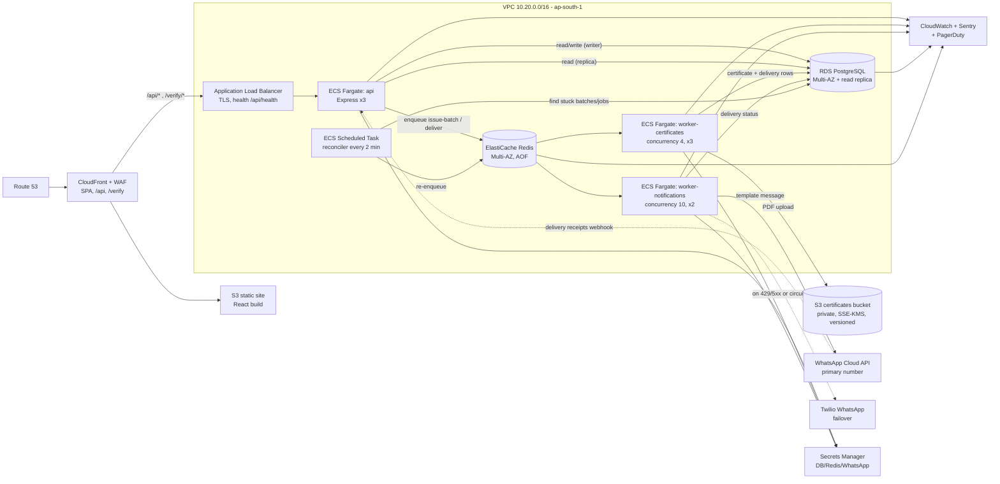

# CertiFlow — Production Deployment Plan

**Scope:** plan only (the hackathon submission does not deploy). This document describes how to
run CertiFlow for **100,000 registered users / ~10,000 DAU**, with a results-day peak of
**500 batches approved per hour → 30,000 PDFs + 30,000 WhatsApp messages**, plus bursty public
verification traffic.

Reference implementation: this repository (`server/`, `client/`, `prisma/`).
Recommended platform: **AWS, `ap-south-1` (Mumbai)** — closest region to the user base and to
Meta's WhatsApp Cloud API edge; GCP/Azure equivalents are noted in the trade-offs.

---

## 1. Load model and capacity math

| Dimension | Given | Derived | Design target (3× headroom) |
| --- | --- | --- | --- |
| Registered users | 100,000 | ~50 MB of user rows | trivial |
| Daily active users | ~10,000 | ~10 rps average API traffic | 60 rps |
| Peak batches | 500 / hour | 8.3 / minute, 0.14 / s | 30 / minute |
| Candidates per batch | assumed 60 | 30,000 certificates / hour | 30,000 in ≤ 40 min |
| PDF generation | 30,000 / hour | **8.3 PDF/s average**; if 50% arrive in 20 min → 12.5/s | **25 PDF/s sustained** |
| WhatsApp sends | 30,000 / hour | 8.3 msg/s | 25 msg/s (provider cap ~80/s per number) |
| Public verification | several thousand/day, bursty | 5,000/day avg; burst 50 rps for 10 min | **200 rps** with 30 s cache |
| DB writes at peak | batches + certificates + jobs + audit | ~35 rows/s | 200 rows/s |
| PDF storage | 30,000 × ~150 KB (logo/fonts) | ~4.5 GB per results day; ~75 GB/year at 500k certs | S3, 7-year retention |

Why these targets are safe:

* **CPU budget for PDFs.** PDFKit renders this template in ~30–80 ms of CPU. At 8 PDF/s that is
  ~0.5 vCPU; at the 25 PDF/s design target ~1.5 vCPU. A 2-vCPU worker task with BullMQ
  concurrency 2–4 yields ~12–16 PDF/s, so **3 tasks** cover the peak with headroom and survive
  losing one task.
* **DB budget.** 30k certificate inserts + 30k delivery-job rows + ~60k audit rows in an hour is
  ~35 rows/s — far below a `db.r7g.large` (≈5k simple writes/s). The bottleneck is **connection
  count and lock contention**, not write volume.
* **Redis budget.** 30k jobs × ~1 KB payload ≈ 30 MB; with `removeOnComplete`/`removeOnFail`
  caps the working set stays under ~200 MB.
* **Verification budget.** Each lookup is a single unique-index read (`certificateNumber` or
  `verificationToken`). A 30 s CDN/Redis cache removes >90% of DB reads during bursts.

---

## 2. Service level objectives

| Journey | SLO |
| --- | --- |
| API availability (authenticated) | 99.9% monthly |
| Public verification availability | 99.95% (must survive DB maintenance) |
| Verification p95 latency | < 300 ms (cache hit < 80 ms) |
| Batch approval → certificates issued | p95 < 5 min, p99 < 15 min at peak |
| Certificate → WhatsApp delivered | 99% within 15 min; failures visible and replayable |
| Durability | RPO 0 for PostgreSQL data; ≤ 2 s for queue jobs |

---

## 3. Architecture

### 3.1 Diagram — services, data stores, event flow



### 3.2 Synchronous request path

```
Browser → CloudFront/WAF → ALB → API (one of 3 stateless tasks)
                                   ├─ Prisma → RDS writer (all writes, locks)
                                   ├─ Prisma → RDS read replica (list/detail/reports)
                                   └─ BullMQ Queue.add (Redis)
```

State lives only in PostgreSQL; any API task can serve any request (no sticky sessions).

### 3.3 Asynchronous event flow (the critical path)

1. **State approval (write + commit).** `POST /api/batches/:id/state-decision` records
   `APPROVED` and its audit row in one transaction — the approval is durable before anything
   else happens.
2. **Issuance request.** The API adds `issue-batch` (`jobId: issue-batch-<batchId>`) to the
   `certificate-issuance` queue (Redis).
3. **Certificate worker.** Consumes the job, then per candidate: `INSERT Certificate` (unique
   `candidateId`, deterministic number), render PDF (PDFKit), `PUT` to S3
   (`certs/2026/11/CF-….pdf`, SHA-256 stored), `INSERT DeliveryJob`, `Queue.add('deliver')`.
   Finally `UPDATE Batch SET status='ISSUED'` (guarded by `WHERE status='APPROVED'`).
4. **Notification worker.** Consumes `deliver`, calls Meta Cloud API with a pre-approved utility
   template, stores `providerRef`, marks `SENT`; on retryable errors it rethrows and BullMQ
   retries with exponential backoff; permanent failures land in `FAILED` (the dead-letter view,
   replayable via `POST /api/batches/:id/issue` / an admin replay job).
5. **Provider receipts.** Meta calls a webhook (`/api/webhooks/whatsapp`) which updates
   `DeliveryJob` with `delivered/read/failed` (small addition over the MVP). Workers never trust
   the synchronous 202 alone.
6. **Verification.** `GET /api/verify/...` reads the certificate by unique index (cache 30 s),
   returns `VALID`/`REVOKED`/`NOT_FOUND`; PDF bytes come from S3 via a 60 s presigned URL.

**Reliability of step 1→2.** The current code enqueues *after* commit; if Redis is unavailable
between commit and enqueue the job is lost. Production fix (recommended before go-live):
a **transactional outbox** — insert a `QueueOutbox` row in the same transaction as the approval,
and let a relay (the scheduled reconciler) publish and mark it. A cheaper interim mitigation is
the reconciler described in §6.5, which re-enqueues `APPROVED` batches without certificates.

---

## 4. Where each component is hosted, and why

| Component | Hosting | Why |
| --- | --- | --- |
| React SPA | **S3 + CloudFront** | Static, cheap, global edge caching, no servers to patch; CloudFront also fronts the API for WAF/TLS/rate limiting |
| API (`api` image) | **ECS Fargate service**, 3 tasks across 3 AZs, behind ALB | Stateless Node service; Fargate removes AMI/patching work and scales within ~60 s for bursty results-day load; ALB health checks use the existing `/api/health` |
| Certificate worker | **ECS Fargate service** (same image, different command), 3 tasks, 2 vCPU/4 GB | CPU-bound PDF rendering; separate service so queue backlog scales independently of web traffic |
| Notification worker | **ECS Fargate service**, 2 tasks, 0.5 vCPU/1 GB | I/O-bound (HTTPS to provider); cheap tasks, concurrency 10, separate failure domain |
| Reconciler / DLQ replay | **ECS Scheduled Task** (EventBridge rule, every 2 min) | Repairs the only real gap (commit-then-enqueue) and replays stuck deliveries without human involvement |
| PostgreSQL | **RDS PostgreSQL 16, Multi-AZ**, `db.r7g.large` + **read replica**, gp3 200 GB, PITR 7 days | Source of truth; Multi-AZ gives automatic failover (< 60 s); replica isolates read-only verification/reporting from approval locks; managed backups remove operational risk |
| Connection pooling | **RDS Proxy** (or PgBouncer sidecar) | 8+ Node processes × Prisma pools would exhaust connections; proxy multiplexes to < 100 backend connections |
| Redis / queues | **ElastiCache for Redis 7, Multi-AZ**, 2 × `cache.t4g.medium`, AOF everysec, automatic failover | BullMQ needs a real Redis with persistence; managed failover avoids restarting workers by hand; small instance is sufficient at 30k jobs/hour |
| Certificate PDFs | **S3** private bucket, SSE-KMS, versioning, Object Lock (governance), Block Public Access | Durable (11 nines), cheap, supports presigned access control and 7-year retention; removes the MVP's local-disk single point of failure |
| Secrets | **AWS Secrets Manager** + KMS | No credentials in images or env files; rotation without redeploy |
| Registry | **ECR** with image scanning on push | Immutable `sha-<git>` tags, vulnerability scan before deploy |
| Observability | **CloudWatch** (metrics/logs/alarms), **Sentry** (exceptions), **PagerDuty** (on-call) | Native ECS/RDS/ElastiCache metrics; one alerting path |
| WhatsApp | **Meta WhatsApp Cloud API** (primary) + **Twilio** (failover) | Direct pricing, 80 msg/s per number, template management; failover covers provider outages |
| DNS / TLS | Route 53 + ACM certificates | Managed certificates and health-checked failover records if multi-region is added later |

Network: private subnets for ECS/RDS/Redis, public subnets only for ALB/NAT; S3 and ECR reached
through **VPC endpoints** (removes most NAT data cost); security groups allow ALB→API only, API
and workers→RDS/Redis only.

**Region choice:** `ap-south-1` for latency to Indian users and Meta edge. Multi-region active-
passive (CloudFront origin failover + RDS cross-region read replica) is a later option at roughly
+60% infrastructure cost — not required for this load.

---

## 5. Scaling

### 5.1 What scales horizontally

| Component | Scaling signal | Min / max | Notes |
| --- | --- | --- | --- |
| API | CPU 60% or ALB `RequestCountPerTarget` 700/min | 3 / 12 | Stateless; scale-out in ~60 s |
| Certificate worker | CloudWatch custom metric `QueueWaiting / RunningTasks > 5` | 3 / 12 | CPU-bound; also scale on ECS CPU 70% |
| Notification worker | `QueueWaiting / RunningTasks > 50`; provider 429 rate | 2 / 10 | I/O-bound; watch provider rate limits, not CPU |
| Read replica | Replica CPU / lag | 1 / 3 | Verification reads can be served by any replica |
| CloudFront | automatic | — | Absorbs verification bursts at the edge |

Queue-depth metrics are published by a tiny exporter (BullMQ `queue.getJobCounts()` every 30 s)
as CloudWatch custom metrics; Application Auto Scaling target-tracks them. If queue sharding
becomes necessary (§5.3), the exporter sums across shards.

### 5.2 What limits throughput at peak

| Limit | Number at peak | Headroom | Mitigation if exceeded |
| --- | --- | --- | --- |
| **PDF CPU** | 8.3/s required, ~12–16/s per task | 3 tasks = 36–48/s | Add tasks to max 12 (≈100 PDF/s); reduce PDF size; cache fonts outside the request |
| **WhatsApp provider rate** | 8.3 msg/s; 80/s per phone number | 10× | Throttle with a token bucket; add a second number/template |
| **WhatsApp messaging tier** | 30k unique recipients/day | needs the **100K tier** (upgrade 24 h before) | Meta tier upgrade; fallback SMS for critical notices |
| **PostgreSQL connections** | ~8 processes × 5–9 | RDS Proxy keeps < 100 | Cap Prisma pools, use proxy |
| **Row locks on approvals** | 1 lock per batch; 0.14 batches/s | high | Locks held only for a short transaction; no change needed |
| **Single Redis shard** | 30k jobs/hour, ~30 MB | ≫ 10× | Shard queues only if > 100k jobs/hour |
| **Audit table growth** | ~60k rows/hour at peak | fine | Monthly partitioning + 24-month retention |
| **ALB/CloudFront** | 200 rps design | high | Edge cache + WAF rate limits |

### 5.3 Backlog clearing on results day

```
backlog_eta = queue_waiting / effective_throughput
```

* Target: backlog clears in **≤ 30 min** after the approval spike (< 5 min at normal peaks).
* Pre-scale at T-1 hour: certificate workers min 6, notification workers min 4 (cost is a few
  dollars for the day). Autoscaling handles the rest, reacting to `QueueWaiting` rather than CPU
  (jobs waiting with idle workers is the signal that matters).
* The queue is FIFO per queue; a `priority` field can be added so the state office can push a
  specific batch to the front (`job.opts.priority`).
* If a shard is hot: split by `trainingCentreId % 4` into four queue names sharing the same Redis,
  or into four Redis nodes with separate prefixes; workers of each shard are independent
  deployments.
* If WhatsApp is the bottleneck (provider 429), certificate generation keeps running and the
  delivery queue absorbs the backlog — certificates are not blocked by messaging (§6.3).

---

## 6. Failure handling

### 6.1 Worker crash (OOM, exception, node failure)

* **Detection:** ECS task stopped/restart count; BullMQ `stalled` counter; alarm on
  `queue.stalled > 0` or on `failed` rate > 1%.
* **Mechanism:** BullMQ locks a job for `lockDuration` (30 s) and re-delivers it if the worker
  dies (`maxStalledCount: 2`). ECS replaces the task automatically.
* **Safe because:** issuance is idempotent — `Certificate.candidateId` unique, deterministic
  number, PDF reused when `pdfPath`/S3 key exists, `DeliveryJob` upserted by `certificateId`.
  Delivery attempts are persisted **before** the provider call, so a crash mid-call cannot
  produce an untracked send.
* **Recovery:** zero manual action for the task; reconciler covers jobs that were never enqueued.
* **RTO:** ~1 min (task replacement). **RPO:** 0 (all state in RDS).

### 6.2 Redis restart / failover

* **Detection:** `/api/health` shows `redis: down`; ElastiCache failover event; worker
  `ECONNREFUSED` logs; queue depth metric stops updating.
* **Blast radius:** producers can't enqueue, workers can't consume. PostgreSQL is unaffected —
  approvals, verification and downloads keep working.
* **Mitigation:**
  * ElastiCache Multi-AZ **automatic failover** (30–90 s), AOF `appendfsync everysec` and a
    replica, so at most ~1 s of writes can be lost.
  * ioredis reconnects with capped backoff; BullMQ workers keep their connection alive and
    resume consuming after DNS switches to the new primary.
  * Run production with `QUEUE_MODE=bullmq` (not `auto`) so an outage is **loud** — tasks fail
    health/startup and alarms fire instead of silently degrading to in-process work. Note: the
    MVP caches the resolved mode per process, so `auto` would stay in `sync` after recovery until
    a restart; `bullmq` avoids that trap.
* **Lost-work recovery:** the **reconciler** runs every 2 minutes:
  ```sql
  -- approved but never issued
  SELECT id FROM "Batch"
  WHERE status = 'APPROVED' AND "updatedAt" < now() - interval '3 minutes';
  -- queued but never attempted
  SELECT id FROM "DeliveryJob"
  WHERE status = 'PENDING' AND attempts = 0 AND "createdAt" < now() - interval '5 minutes';
  ```
  It re-enqueues with the same idempotent jobs. **RTO:** 2–3 min for background work.
  **RPO:** ≤ 1–2 s of enqueued jobs (recoverable), 0 for database state.

### 6.3 WhatsApp outage / degradation

* **Detection:** provider 5xx/429/timeout rate, `DeliveryJob.lastError`, circuit-breaker state,
  delivery success ratio alarm (< 97% over 10 min).
* **Mitigation:**
  * **Circuit breaker** around the provider: open after 20 consecutive failures or >50% errors
    over 60 s; while open, jobs are re-queued with delay instead of hammering the API.
  * **Exponential backoff with jitter** (existing `attempts` + `backoff`; add ±20% jitter to
    avoid retry storms), attempts capped by `WHATSAPP_MAX_ATTEMPTS`.
  * **Provider failover** behind a `WhatsAppProvider` interface (Meta → Twilio) selected by
    config; health-checked every minute.
  * **Dead-letter:** exhausted jobs stay `FAILED` and are listed in the state office UI; a replay
    endpoint resets `attempts` and re-enqueues (`POST /api/admin/deliveries/:id/replay`). Replay
    **never** creates a certificate — delivery only reads the existing one.
  * **Throttling:** token bucket sized to the provider's per-number throughput; if `429`, respect
    `Retry-After`, then resume at 50% rate for 5 minutes.
* **Business impact:** certificates are already valid and verifiable; recipients can be reached
  later. No duplicate certificates, no duplicate batches.

### 6.4 Slow database

* **Detection:** RDS `CPUUtilization > 80%`, `DatabaseConnections > 80%`, `ReadLatency`/p95 query
  time alarms, Prisma pool wait warnings, ALB target p95 > 500 ms.
* **Prevention/limits:** `statement_timeout=5s`, `lock_timeout=3s`, Prisma transaction timeout
  10 s; short transactions only (the approval flow holds a row lock for milliseconds); no N+1 in
  the verification hot path (single indexed query); indexes already cover
  `Certificate(certificateNumber)`, `Certificate(verificationToken)`, `Batch(district,status)`,
  `Approval(roundId,decision)`.
* **Mitigation:**
  * Verification served from the **read replica** + 30 s cache (CDN/Redis) — a primary slowdown
    does not break public verification.
  * RDS Proxy absorbs connection storms; cap Prisma pool (`connection_limit=10` per process).
  * Autoscale API/workers on latency; **shed non-critical load** first (reports, list endpoints)
    behind a feature flag.
  * If CPU stays high: scale the instance class (`r7g.large → xlarge`) — a single reboot/failover
    window; or kill long queries via `pg_terminate_backend` after review.
  * If writes are the issue: batch the audit writes (buffer + periodic insert) — never drop them.
* **Lock contention:** the district-approval `SELECT … FOR UPDATE` is scoped to one batch row, so
  500 batches/hour cannot contend with each other. A stuck transaction is visible in
  `pg_stat_activity` (`wait_event_type='Lock'`) and is alarmed.

### 6.5 Reconciliation and dead-letter summary

| Failure | Safety net | Frequency |
| --- | --- | --- |
| Redis down between commit and enqueue | Reconciler re-enqueues `APPROVED` batches without certificates | every 2 min |
| Worker dies mid-job | BullMQ stalled-job redelivery + idempotent service | automatic |
| Delivery never attempted | Reconciler picks up `PENDING` jobs with `attempts = 0` | every 2 min |
| Delivery permanently failed | `FAILED` view + manual replay endpoint | on demand |
| Partial PDF upload | S3 `PutObject` is atomic; DB updated only after success; retry re-renders | automatic |
| Duplicate provider send after replay | Idempotency key = `certificateNumber` sent to provider when supported; duplicates logged | — |

---

## 7. Certificate file storage and access control

### 7.1 Storage

* **Bucket:** `certiflow-certificates-<env>-<account>` — **private**, Block Public Access on,
  bucket policy denies non-TLS requests, `s3:DeleteObject` allowed only for the lifecycle role.
* **Encryption:** SSE-KMS with a customer-managed key; key policy limited to the ECS task roles
  and the lifecycle role.
* **Versioning + Object Lock** (governance, 7 years) so a certificate cannot be silently replaced.
* **Key layout:** `certs/{yyyy}/{mm}/{certificateNumber}.pdf` — deterministic, so retries
  overwrite the same object (idempotent).
* **Integrity:** SHA-256 + size stored on `Certificate`; nightly job samples 1% and compares.
* **Retention:** Standard for 12 months → Glacier Instant Retrieval; 7 years total (policy
  requirement, cheap at ~$0.004/GB-month).
* **Backup:** cross-region replication (optional, +$5–10/mo) or weekly export to a second account.

### 7.2 Access control

| Consumer | Path | Control |
| --- | --- | --- |
| Training centre / district / state / quality | `GET /api/certificates/:id/pdf` → API checks role + scope (owning centre, same district, or state/quality) | **60 s presigned S3 URL**; the API never proxies bytes; every download writes an audit row |
| Public verifier with token | `GET /api/verify/token/:token/pdf` | Token is a 128-bit random value (already implemented); rate limit 10/min/IP + WAF bot control; presigned URL |
| Anyone | Verification metadata | No phone numbers or unnecessary PII (already enforced in `toPublicCertificate`) |
| Internal | Worker upload | Task role can `PutObject` only under `certs/*`; no `GetObject` on other prefixes |

* No bucket credentials are ever shipped to the browser.
* Public verification responses are cacheable for 30 s; revocation **purges** the CDN path for
  that certificate number/token so `REVOKED` is visible immediately (or TTL ≤ 30 s).
* Optional: short-lived signed CloudFront URLs instead of S3 presigning if a CDN domain is
  preferred for PDFs.

### 7.3 Code change required (small, isolated)

The MVP writes PDFs to `STORAGE_DIR` and stores `Certificate.pdfPath`. Production needs a storage
adapter:

```ts
interface CertificateStore {
  put(key: string, bytes: Buffer, contentType: string): Promise<{ key: string; sha256: string }>;
  presignGet(key: string, ttlSeconds: number): Promise<string>;
}
```

`renderCertificatePdf` returns bytes; `certificateService` calls `store.put('certs/2026/11/….pdf')`
and stores `pdfKey` + `sha256`. `routes/certificates.ts` and the public token route return a 302
to the presigned URL. Everything else (idempotency, numbering, revocation) is unchanged.

---

## 8. Monitoring and alerting

### 8.1 Metrics

| Layer | Metric | Why |
| --- | --- | --- |
| API | request rate, p50/p95/p99 latency, 4xx/5xx rate, ALB `UnHealthyHostCount`, event-loop lag | Golden signals |
| Business | batches by status, time from `APPROVED` to `ISSUED`, approvals per minute | Detect stuck workflows |
| Queue | `waiting`, `active`, `delayed`, `failed`, `stalled`, oldest job age, per-queue throughput | Backlog and worker health |
| Worker | job duration per type, PDF render ms, delivery attempts histogram | Capacity planning |
| Provider | WhatsApp 2xx/4xx/429/5xx, p95 latency, circuit state, delivery success % | Outage detection |
| Verification | rps, cache hit ratio, p95 latency, `NOT_FOUND` rate | Burst handling + enumeration detection |
| PostgreSQL | CPU, connections, IOPS, read/write latency, replica lag, lock waits, slow queries (`pg_stat_statements`), deadlocks | The real bottleneck |
| Redis | CPU, memory used, evicted keys (**must be 0**), connections, replication lag, persistence errors | Evictions break job guarantees |
| Storage | S3 4xx/5xx, presign failures, bucket size | Download path |
| Host | ECS task restarts, OOM kills | Crashes |

### 8.2 Alarms

| Severity | Alarm | Threshold | Action |
| --- | --- | --- | --- |
| P1 | API 5xx rate | > 2% for 5 min | Page on-call; check DB/Redis/provider |
| P1 | Public verification failures | > 5% for 5 min | Failover cache / check replica |
| P1 | Queue oldest job age | > 15 min | Scale workers, check stalled jobs |
| P1 | `APPROVED` batch without certificates | exists > 10 min | Run reconciler, inspect worker logs |
| P1 | Redis evictions | > 0 in 5 min | Increase memory / fix retention policy immediately |
| P2 | Delivery success rate | < 97% over 15 min | Open circuit, check provider status, prep failover |
| P2 | DB CPU | > 80% for 10 min | Scale class / kill long query |
| P2 | DB connections | > 80% of max | Check pool leaks / proxy |
| P2 | RDS replica lag | > 10 s | Route verification to primary temporarily |
| P2 | Certificate worker CPU | > 85% for 10 min | Scale out |
| P3 | `NOT_FOUND` verification ratio | > 50% for 10 min | Possible enumeration; tighten WAF rate limit |
| P3 | Audit write failures | > 0 | Investigate DB pressure (audit is a hard requirement) |

Dashboards: **Results-day** (queue ETA, certificates/min, deliveries/min, error rates),
**Platform** (API/DB/Redis), **Business** (batches by state, revocations, verifications).

Synthetic canary every minute: `/api/health` and a known-token verification must return 200 /
`VALID`; failures page immediately, independent of internal metrics.

### 8.3 Load testing and game day

* **k6** scenarios: 30k certificates in 1 hour (ramping batches), 30k deliveries, verification at
  200 rps for 10 minutes, and a 3× spike.
* Run **T-7 days** and again T-2; record PDF/s per task and DB latency to set autoscaling targets.
* Verify the reconciler by killing Redis mid-run and confirming automatic recovery inside 3 min.
* Verify a worker kill (`docker kill`/ECS stop task) mid-batch → no duplicate certificates.
* Restore a PITR snapshot into a scratch instance and time it (target < 30 min).

---

## 9. Rough monthly cost and trade-offs

Assumptions: `ap-south-1`, on-demand, 24/7 baseline, ~300k certificates/messages per month,
1 TB CloudFront egress, single region, USD (≈ ₹83/USD).

| Item | Configuration | Monthly (USD) |
| --- | --- | --- |
| API — ECS Fargate | 3 × (1 vCPU / 2 GB) | 125 |
| Certificate workers | 3 × (2 vCPU / 4 GB) baseline | 250 |
| Notification workers | 2 × (0.5 vCPU / 1 GB) | 40 |
| Reconciler scheduled task | 2 min cadence, ~10 s runtime | 5 |
| RDS PostgreSQL | `db.r7g.large` Multi-AZ + 200 GB gp3 + backups | 380 |
| RDS read replica | `db.r7g.large` | 170 |
| RDS Proxy | 1 proxy | 15 |
| ElastiCache Redis | 2 × `cache.t4g.medium` Multi-AZ, AOF | 105 |
| ALB | 1 ALB + LCU | 35 |
| NAT Gateways | 2 AZ (+ VPC endpoints for S3/ECR) | 65 |
| S3 (PDFs) | ~100 GB + requests, versioning | 10 |
| CloudFront + WAF | 1 TB + 10M requests + rules | 80 |
| Route 53, ACM | hosted zone + certs | 3 |
| Secrets Manager + KMS | 3 secrets, 1 CMK | 12 |
| CloudWatch + Sentry + PagerDuty | logs, metrics, errors, paging | 90 |
| ECR | images + scans | 5 |
| **WhatsApp** | 300k utility templates × ~$0.002 | 600 |
| **Total (baseline)** | | **≈ 1,990** |

**Burst (results day):** +6 certificate tasks and +4 notification tasks for ~4 hours ≈ **+$100–150**;
CloudFront/S3 increments are a few dollars.

**Range:** a lean single-AZ variant (no replica, no Multi-AZ Redis, smaller workers) ≈ **$1,150**;
a fully redundant variant (larger RDS, 3 AZs, cross-region S3 replication) ≈ **$2,600**.
Cost per certificate at 300k/year ≈ **$0.08** all-in (≈ $0.03 excluding WhatsApp).

### Trade-offs behind the numbers

| Decision | Cost | What you buy | What you give up |
| --- | --- | --- | --- |
| Fargate vs EC2 + Savings Plans | +25–35% | No patching, second-scale scaling for bursty PDF work | ~$300/mo savings at steady state; EC2 is the option if load becomes constant |
| Multi-AZ RDS + Redis | +55% on data tier | Failover in < 60–90 s; results day is one-shot and unforgiving | ~$350/mo |
| Read replica | +$170 | Verification survives primary load; reporting isolation | Slight replication lag (acceptable: 30 s cache already) |
| ElastiCache vs self-managed Redis on EC2 | +$60 | Automated failover, backups, patching | A t4g.small VM could run it for ~$15 but with manual ops |
| BullMQ on Redis vs SQS | +$0 infra, −$0 code | Retries, backoff, job introspection, priorities; code already built and tested | SQS would be cheaper at 10× volume but requires a rewrite and loses queue introspection |
| Meta Cloud API direct vs BSP | −20–30% | Lower per-message price, better control | Twilio (BSP) gives easier failover and support; plan keeps Twilio as standby |
| CloudFront 30 s verification cache | −$100+ DB/compute | Absorbs bursts cheaply | Revocation visibility up to 30 s unless purged on revoke |
| CloudFront vs API-direct | +$80 | WAF, TLS, edge caching, DDoS absorption | Extra component to configure |
| Single region | — | Simpler, cheaper | No region-level DR; acceptable at this SLO/RTO |

---

## 10. Container images and release process

The app is container-ready today (the compiled build was verified in this workspace:
`npm run build` emits `dist/index.js` and `dist/workers/*.js`, and `node dist/index.js` serves
`/api/health`).

### 10.1 One image, three commands (build context = repo root)

```dockerfile
# Dockerfile  (reference — Docker is not available on the demo machine)
# syntax=docker/dockerfile:1.7
FROM node:20-bookworm-slim AS deps
WORKDIR /app
RUN apt-get update && apt-get install -y --no-install-recommends openssl ca-certificates \
    && rm -rf /var/lib/apt/lists/*
COPY package.json package-lock.json ./
COPY server/package.json server/
COPY client/package.json client/
RUN npm ci --workspace server --include-workspace-root

FROM deps AS build
COPY server ./server
RUN npx prisma generate --schema server/prisma/schema.prisma \
 && npm run build --workspace server

FROM node:20-bookworm-slim AS runtime
WORKDIR /app
RUN apt-get update && apt-get install -y --no-install-recommends openssl dumb-init \
    && rm -rf /var/lib/apt/lists/*
ENV NODE_ENV=production
COPY --from=build /app/node_modules ./node_modules
COPY --from=build /app/server/dist ./dist
COPY --from=build /app/server/prisma ./prisma
COPY --from=build /app/server/package.json ./package.json
USER node
EXPOSE 4000
ENTRYPOINT ["dumb-init", "--"]
CMD ["node", "dist/index.js"]
```

Task definitions (same image digest):

| ECS service | Command | CPUs / memory | Desired |
| --- | --- | --- | --- |
| `api` | `node dist/index.js` | 1 vCPU / 2 GB | 3 |
| `worker-certificates` | `node dist/workers/certificateWorker.js` | 2 vCPU / 4 GB | 3 |
| `worker-notifications` | `node dist/workers/notificationWorker.js` | 0.5 vCPU / 1 GB | 2 |
| `migrate` (one-off) | `npx prisma migrate deploy` | 0.5 vCPU / 1 GB | — |
| `reconciler` (scheduled) | `node dist/scripts/reconcile.js` | 0.25 vCPU / 0.5 GB | — |

Production environment (Secrets Manager → container env):

```dotenv
NODE_ENV=production
PORT=4000
DATABASE_URL=postgresql://certiflow:<secret>@<rds-proxy>:5432/certiflow?connection_limit=10&pool_timeout=10
REDIS_URL=rediss://:<auth-token>@<elasticache-primary>:6379
QUEUE_MODE=bullmq
STORAGE_DRIVER=s3
S3_BUCKET=certiflow-certificates-prod
STORAGE_DIR=/tmp/certificates          # only used by the local driver
PUBLIC_BASE_URL=https://certiflow.gov.example
WHATSAPP_MODE=live                     # replaces the simulator in production
WHATSAPP_PROVIDER=meta                 # meta | twilio
WHATSAPP_MAX_ATTEMPTS=5
JWT_ISSUER=https://sso.example         # OIDC replaces demo login in production
```

`QUEUE_MODE=bullmq` in production is deliberate: a Redis outage should page someone, not
silently switch to in-process work.

### 10.2 Pipeline

1. PR: `npm run check`, `npm test`, `npm run build` (CI runs PostgreSQL as a service).
2. Merge → build image → Trivy/ECR scan → push `sha-<git>`.
3. **Migrations first:** run the `migrate` task with the new image; migrations must be
   backward-compatible (expand → migrate → contract) because old tasks still serve traffic.
4. Rolling deploy: ECS circuit breaker + rollback, `minimumHealthyPercent=100`,
   `maximumPercent=200`; workers receive `SIGTERM` and finish active jobs (`worker.close()`).
5. Smoke: `/api/health`, one verification lookup, one synthetic batch in staging.
6. Rollback: redeploy the previous image digest (safe because migrations are additive).

### 10.3 Small single-VM option (staging / pilot)

If Fargate is not available, the same image runs on one 4 vCPU / 8 GB VM with Docker Compose:
`api`, `worker-certificates`, `worker-notifications`, `postgres:16`, `redis:7-alpine` (AOF on),
`nginx` (TLS + static SPA). Cost ≈ **$60–100/month**, but single-AZ with no failover — suitable
for staging or a pilot, not for results day. Compose skeleton:

```yaml
services:
  postgres:
    image: postgres:16
    environment: [POSTGRES_DB=certiflow, POSTGRES_USER=certiflow, POSTGRES_PASSWORD=${PG_PASSWORD}]
    volumes: [pgdata:/var/lib/postgresql/data]
  redis:
    image: redis:7-alpine
    command: ["redis-server", "--appendonly", "yes", "--maxmemory-policy", "noeviction"]
    volumes: [redisdata:/data]
  migrate:
    image: certiflow-api:sha
    command: ["npx", "prisma", "migrate", "deploy"]
    depends_on: [postgres]
  api:
    image: certiflow-api:sha
    ports: ["4000:4000"]
    depends_on: [postgres, redis, migrate]
    env_file: [.env.production]
  worker-certificates:
    image: certiflow-api:sha
    command: ["node", "dist/workers/certificateWorker.js"]
    depends_on: [postgres, redis]
    env_file: [.env.production]
  worker-notifications:
    image: certiflow-api:sha
    command: ["node", "dist/workers/notificationWorker.js"]
    depends_on: [postgres, redis]
    env_file: [.env.production]
volumes: { pgdata: {}, redisdata: {} }
```

`redis` uses `noeviction` on purpose — evicting BullMQ keys loses jobs.

---

## 11. Production hardening backlog (gap analysis vs this MVP)

| # | Gap in MVP | Production action | Priority |
| --- | --- | --- | --- |
| 1 | Demo login (pick a user) | OIDC/SSO (Cognito/Keycloak/Auth0) with role claims; keep the same `AuthUser` shape and middleware | P0 |
| 2 | Enqueue happens after commit | Transactional outbox + relay, or the reconciler in §6.5 as the interim | P0 |
| 3 | PDFs written to local disk | S3 adapter + presigned downloads (§7.3) | P0 |
| 4 | WhatsApp is simulated | Provider interface: Meta Cloud API + Twilio fallback, template IDs, receipts webhook, token-bucket throttle | P0 |
| 5 | No global rate limiting | WAF rate rules; per-IP limits on `/api/verify/*`; slowapi/express-rate-limit in the API | P1 |
| 6 | `AuditLog` grows unbounded | Monthly partitions, 24-month hot retention, archive to S3 | P1 |
| 7 | Deterministic `jobId` can block a manual replay while the old job is retained | Add an attempt suffix for replays, or delete the job before re-adding | P1 |
| 8 | No tracing/metrics export | OpenTelemetry traces, CloudWatch EMF business metrics, Sentry release tracking | P1 |
| 9 | `auto` queue mode caches the decision per process | Use `bullmq` in production (fail loud) | P1 |
| 10 | No backups/DR drill | RDS PITR + cross-region copy; quarterly restore test | P1 |
| 11 | No load tests in CI | k6 suite at 3× peak before results day | P2 |

---

## 12. Results-day runbook

**T-7 — readiness**
- [ ] k6 at 3× peak passes; PDF/s per task recorded; autoscaling targets validated
- [ ] WhatsApp template **approved**, messaging tier upgraded to **100K**, second number ready
- [ ] Reconciler running in prod; kill-Redis drill recovered in < 3 min
- [ ] Alarms routed to PagerDuty with a named on-call; dashboard link shared
- [ ] Restore drill of a PITR snapshot completed

**T-1 — pre-scale** (freeze deploys after this point)
- [ ] Workers min 6 (cert) / 4 (notif); API min 4
- [ ] Manual RDS snapshot; confirm replica lag ≈ 0
- [ ] Verify S3 lifecycle + bucket policy; confirm KMS key access from task roles
- [ ] Load a synthetic batch through the full flow in production (then revoke it)

**T-0 — live**
- [ ] Watch `queue waiting`, `oldest job age`, `certificates/min`, `deliveries/min`, provider 429s,
  DB p95, replica lag
- [ ] Backlog ETA > 20 min → scale cert workers to max
- [ ] Provider 429 > 5% → throttle to 50%, open circuit, fail over to Twilio
- [ ] DB p95 > 300 ms → check `pg_stat_activity`, scale class
- [ ] Any `APPROVED` batch without certificates > 10 min → run reconciler, inspect worker logs

**T+2h — drain**
- [ ] Backlog < 5 min; scale workers back; replay `FAILED` deliveries
- [ ] Verify a sample of certificates publicly; confirm revocations (if any) show `REVOKED`

**T+1 day — review**
- [ ] Post-incident review of alarms; cost report; adjust autoscaling and PDF concurrency
- [ ] Archive audit partition; confirm S3 object counts match `Certificate` rows

---

## 13. Summary

* **Peak is manageable with a small fleet**: 3 certificate tasks cover 8–25 PDF/s; Redis holds
  only ~30 MB of jobs; PostgreSQL sees ~35 writes/s.
* **The real constraints are provider throughput and PDF CPU**, not the database — plan around
  WhatsApp tiers and worker scaling.
* **Correctness is already enforced by the schema** (unique approvals, unique certificates,
  row locks), so scaling workers horizontally does not risk duplicates.
* **The two production gaps that matter** are durable enqueueing (outbox/reconciler) and moving
  PDFs from local disk to S3 with presigned access; both are isolated changes.
* **Baseline ≈ $2,000/month**, of which ~30% is WhatsApp messaging; results-day burst adds
  ~$100–150 for a few hours.
