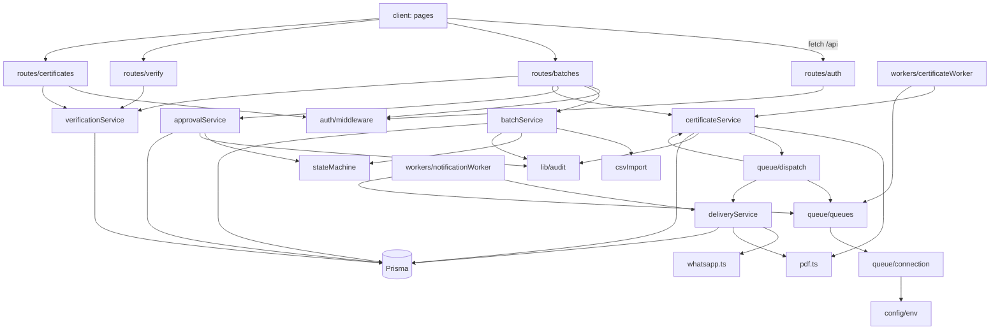
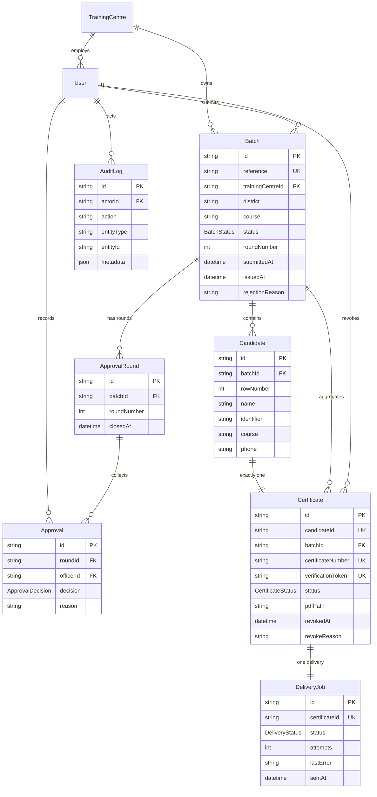

# CertiFlow — Architecture

> Companion documents: [FLOW.md](./FLOW.md) (end-to-end runtime flows),
> [MODULES.md](./MODULES.md) (file-by-file reference + packages),
> [API.md](./API.md) (HTTP contract), [TESTING.md](./TESTING.md) (test matrix).

---

## 1. System shape

CertiFlow is a **modular monolith**:

* one Express application (modular folders, no microservices, no inter-service calls),
* one PostgreSQL database (source of truth),
* optional Redis for queueing,
* four OS processes in the "full" development topology.

```
┌──────────────────────────┐        HTTP/JSON + multipart        ┌──────────────────────────┐
│  React SPA (Vite :5173)  │ ──────────────────────────────────► │  Express API (:4000)     │
│  client/src/**           │ ◄──────────── JSON / PDF ────────── │  server/src/app.ts       │
└──────────────────────────┘                                     └───────────┬──────────────┘
                                                                             │ Prisma
                                                                             ▼
                                                                 ┌──────────────────────────┐
                                                                 │ PostgreSQL 16            │
                                                                 │ Users, Batches,          │
                                                                 │ Candidates, Approvals,   │
                                                                 │ Certificates, Delivery   │
                                                                 │ Jobs, AuditLog           │
                                                                 └───────────▲──────────────┘
                                                                             │ Prisma
        ┌────────────────────────────┐        ┌────────────────────────────┐│
        │ certificate worker         │        │ notification worker        ││
        │ certificate-issuance queue │◄──────►│ whatsapp-delivery queue    ││
        └────────────┬───────────────┘  Redis └────────────┬───────────────┘│
                     │ BullMQ / ioredis (TLS for rediss://)  │                │
                     └───────────────────┬───────────────────┘                │
                                         ▼                                    │
                                 ┌───────────────┐                            │
                                 │ Redis         │                            │
                                 │ (local/Upstash)│                           │
                                 └───────────────┘                            │
                                                                              │
      Generated PDFs  ◄──────── both API and worker write ── server/storage/certificates/
```

Execution modes:

| Mode | Processes | Background work |
| --- | --- | --- |
| `npm run dev` | API + Vite | API process, synchronous fallback (or BullMQ if workers are also started) |
| `npm run dev:all` | API + Vite + certificate worker + notification worker | BullMQ queues |

## 2. Layer responsibilities

| Layer | Location | Responsibility | Never does |
| --- | --- | --- | --- |
| Presentation | `client/src` | Routing, forms, rendering, calling `/api` | Enforce security (server re-checks everything) |
| HTTP | `server/src/routes`, `middleware` | Validation (Zod), auth, status codes, serialisation | Business rules |
| Domain services | `server/src/services` | State machine, approvals, issuance, delivery, verification, PDF, CSV logic | HTTP concerns |
| Persistence | `server/src/lib/prisma.ts`, `prisma/schema.prisma` | Transactions, constraints, indexes | Business decisions |
| Infrastructure | `server/src/queue`, `server/src/workers`, `server/src/lib/redis.ts` | Queue production/consumption, Redis probing, retries | Business rules (calls the same services) |
| Cross-cutting | `server/src/lib/*`, `server/src/config/env.ts` | Audit, errors, config validation | — |

## 3. Module dependency graph



## 4. Data model



### Enumerations

| Enum | Values | Why it matters |
| --- | --- | --- |
| `Role` | `TRAINING_CENTRE`, `DISTRICT_OFFICER`, `QUALITY_TEAM`, `STATE_OFFICE` | Authorization + data scoping |
| `BatchStatus` | `DRAFT`, `PENDING_DISTRICT`, `PENDING_STATE`, `APPROVED`, `ISSUED`, `RETURNED`, `REJECTED` | Only reachable through `stateMachine.ts` |
| `ApprovalDecision` | `APPROVE`, `REJECT`, `RETURN` | Recorded per officer per round |
| `CertificateStatus` | `VALID`, `REVOKED` | Drives public verification |
| `DeliveryStatus` | `PENDING`, `SENT`, `FAILED` | Delivery observability |

### Constraints that carry business meaning

| Constraint | Protection |
| --- | --- |
| `Batch.reference` unique | Human-readable batch id |
| `Candidate @@unique([batchId, identifier])` | No duplicate candidate inside a batch |
| `Candidate @@unique([batchId, rowNumber])` | Deterministic certificate numbering |
| `ApprovalRound @@unique([batchId, roundNumber])` | One open round per submission |
| `Approval @@unique([roundId, officerId])` | **A district officer cannot approve the same round twice** |
| `Certificate.candidateId` unique | **Idempotent issuance** — one certificate per candidate, ever |
| `Certificate.certificateNumber` unique | Second safety net against duplicates |
| `Certificate.verificationToken` unique | Opaque public URL |
| `DeliveryJob.certificateId` unique | One delivery record per certificate |
| Indexes on `Batch(status)`, `Batch(district,status)`, `Approval(roundId,decision)`, `Certificate(batchId)`, `AuditLog(entityType,entityId)` | Query paths used by the UI |

## 5. Package inventory (and exactly where each is used)

### Backend

| Package | Version | Used in | Purpose / logic |
| --- | --- | --- | --- |
| `express` | 4.21 | `src/app.ts`, all routes | HTTP server, JSON/urlencoded body parsing (2 MB limit), routers |
| `cors` | 2.8 | `src/app.ts` | Allow the Vite dev origin (proxy also used) |
| `zod` | 3.24 | `config/env.ts`, `csvImport.ts`, route handlers | Env validation; per-row candidate validation; request payload validation |
| `csv-parse` | 5.6 (`csv-parse/sync`) | `services/csvImport.ts` | Synchronous CSV parsing with header mapping, BOM/trim options |
| `multer` | 1.4 (memory storage) | `routes/batches.ts` | Multipart upload, 2 MB cap, keeps file in memory (no temp files) |
| `@prisma/client` / `prisma` | 5.22 | everything data-related | Typed queries, transactions, unique constraints, `$queryRaw` row locks |
| `jsonwebtoken` | 9.0 | `auth/middleware.ts` | Demo-login JWT (`sub`, `role`, 12 h) |
| `bullmq` | 5.34 | `queue/queues.ts`, `workers/*` | `Queue`, `Worker`, job ids, attempts, exponential backoff, prefix |
| `ioredis` | 5.4 | `queue/connection.ts`, `lib/redis.ts` | Shared connection, TLS for `rediss://`, bounded probe |
| `pdfkit` | 0.15 | `services/pdf.ts` | A4-landscape certificate PDF with border, text blocks, verification URL |
| `dotenv` | 16.4 | `config/env.ts` | Loads `server/.env` |
| `tsx` | 4.19 | dev scripts | Runs TypeScript directly (API, workers, seed, diagnostics) |
| `typescript` | 5.7 | `tsc --noEmit`, build | Static typing |
| `vitest` | 2.1 | `tests/**` | Test runner (forks, single fork, global setup) |
| `supertest` | 7.0 | `tests/workflow.test.ts` | In-process HTTP assertions against `createApp()` |
| `concurrently` | 9.1 (root) | root scripts | Runs API + SPA (+ workers) together |

### Frontend

| Package | Used in | Purpose |
| --- | --- | --- |
| `react` / `react-dom` 18 | `client/src/**` | UI |
| `react-router-dom` 6 | `App.tsx` | Routes, role-guarded redirects, `:token` param |
| `vite` 5 + `@vitejs/plugin-react` | build/dev | Dev server on 5173, `/api` and `/storage` proxy to 4000 |
| `tailwindcss` 3 + `postcss` + `autoprefixer` | `index.css`, `tailwind.config.js` | Styling (component classes in `@layer components`) |
| `typescript` | `tsc --noEmit` / build | Typing |

### No external service is required for the demo

PDF generation is local (PDFKit), WhatsApp is simulated in-process, storage is the local
filesystem. Redis and PostgreSQL are the only external dependencies, both runnable
without Docker.

## 6. Configuration matrix

| Variable | Consumed by | Effect when missing/invalid |
| --- | --- | --- |
| `DATABASE_URL` | Prisma | Startup aborts with DB troubleshooting text (exit 1) |
| `JWT_SECRET` | `auth/middleware.ts` | Falls back to a dev value in non-production |
| `PORT` | `app.ts` | Default 4000 |
| `REDIS_URL` | `env.ts` → `queue/connection`, `lib/redis` | Takes precedence; `rediss://` enables TLS (Upstash) |
| `REDIS_HOST` / `REDIS_PORT` / `REDIS_PASSWORD` | same | Used when `REDIS_URL` is empty |
| `QUEUE_MODE` | `queue/dispatch.ts` | `auto` probes Redis once, then decides |
| `STORAGE_DIR` | `pdf.ts`, static `/storage` | Default `./storage/certificates`, created on demand |
| `PUBLIC_BASE_URL` | `pdf.ts` | Builds the verification URL printed on the PDF |
| `WHATSAPP_MODE` | `services/whatsapp.ts` | `mixed` (deterministic by phone suffix) |
| `WHATSAPP_MAX_ATTEMPTS` | `deliveryService`, workers | Retry ceiling |

Invalid env is a **hard failure** at boot (`zod` parse → printed issues → exit 1), so the app
never runs half-configured.

## 7. Non-functional decisions

| Concern | Decision | Where |
| --- | --- | --- |
| Concurrency safety | Row locks (`SELECT … FOR UPDATE`) + DB unique constraints | `approvalService`, `verificationService` |
| Idempotency | Deterministic certificate numbers + unique `candidateId`; issuance re-reads existing rows | `certificateService` |
| Durability | PostgreSQL is source of truth; Redis holds only jobs | schema + queue |
| Failure visibility | `AuditLog` for every business action; `DeliveryJob.lastError`; `/api/health` | services + `app.ts` |
| Security | JWT re-resolves the user from DB; role + district/centre scoping on every batch read; no phone numbers in public responses | `auth/middleware.ts`, services |
| Graceful shutdown | `SIGINT`/`SIGTERM` close worker, queues, Prisma | workers + `startServer` |
| Debuggability | Queue mode reason exposed in health; sync fallback logs a warning on every dispatch | `dispatch.ts`, `app.ts` |
