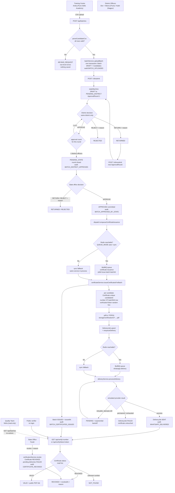
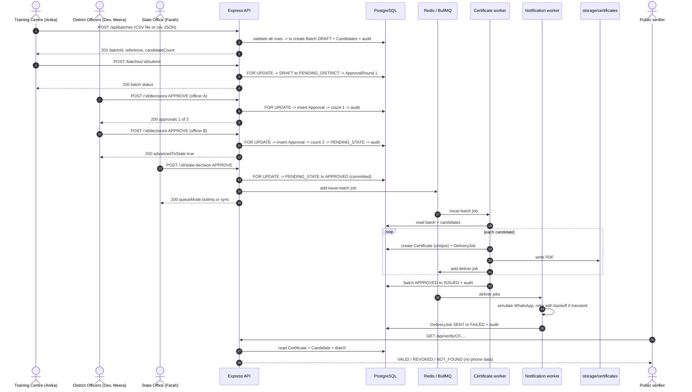
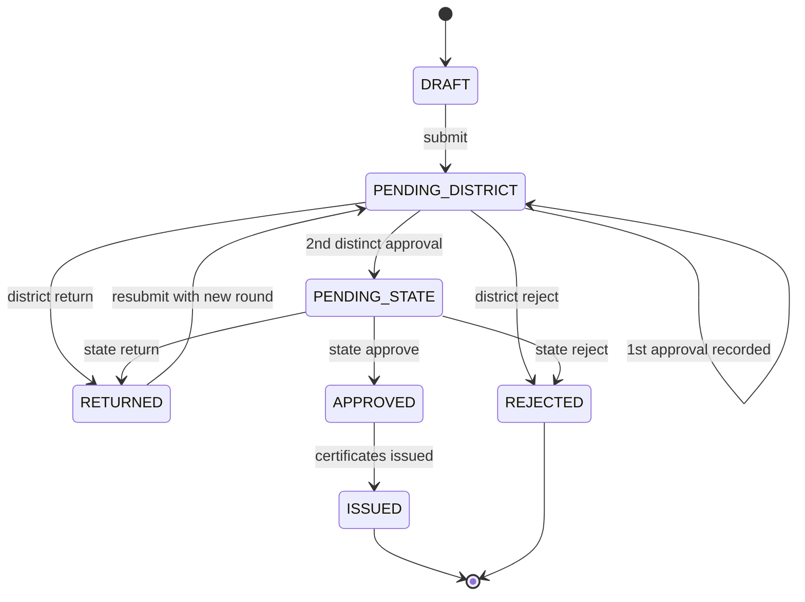
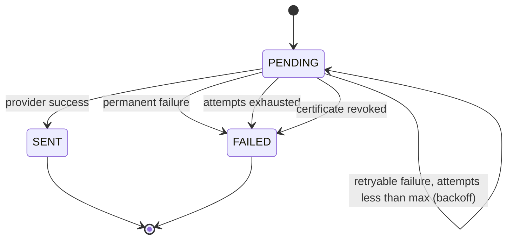
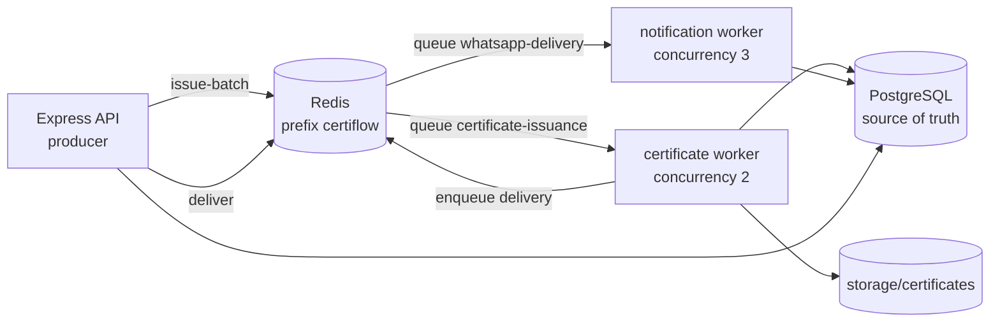
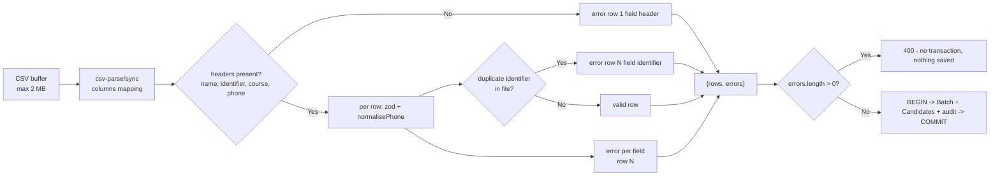

# CertiFlow — Mermaid Diagrams

> All diagrams are derived from the implementation (`server/src/**`, `client/src/**`).
> Related: [FLOW.md](./FLOW.md) for the prose version, [ARCHITECTURE.md](./ARCHITECTURE.md)
> for topology and data model.

---

## 1. End-to-end flow (master diagram)

Covers every role, endpoint, service, queue and storage hop from CSV upload to public
verification, including return/reject/resubmit, the Redis/sync fork, delivery retry and
revocation.

---

## 2. Happy-path sequence (actors and processes)

---

## 3. Batch state machine (single source of truth: `services/stateMachine.ts`)

Notes:

* There is no generic "set status" endpoint — every arrow is a named business operation that
  calls `assertTransition`.
* `ISSUED` is not terminal: certificates can still be revoked (certificate state changes,
  batch stays `ISSUED`).

---

## 4. Delivery job state machine

`attempts` is persisted **before** each provider call, so retries are observable and bounded
by `WHATSAPP_MAX_ATTEMPTS`.

---

## 5. Queue / worker topology

`QUEUE_MODE=sync` (or `auto` with Redis unreachable) removes Redis from the picture: the API
calls `issueCertificatesForBatch` / `processDelivery` directly with the same retry semantics,
and reports `queueMode: "sync"` on `/api/health`.

---

## 6. CSV validation pipeline

