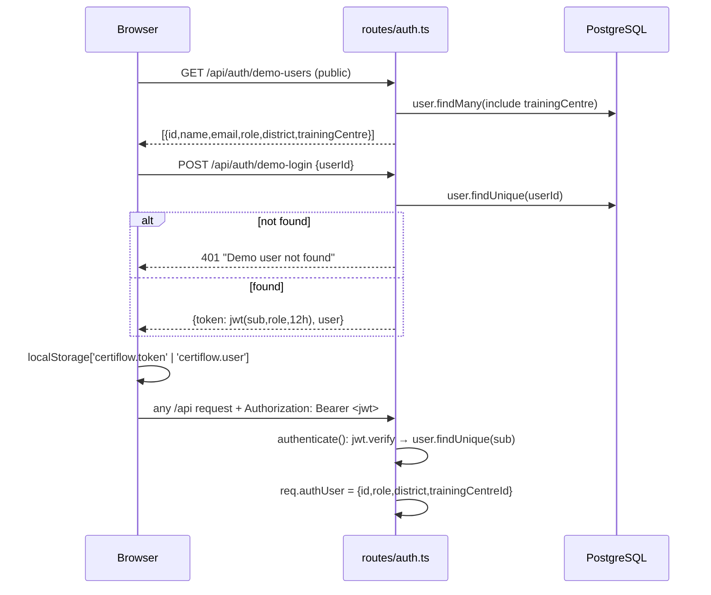
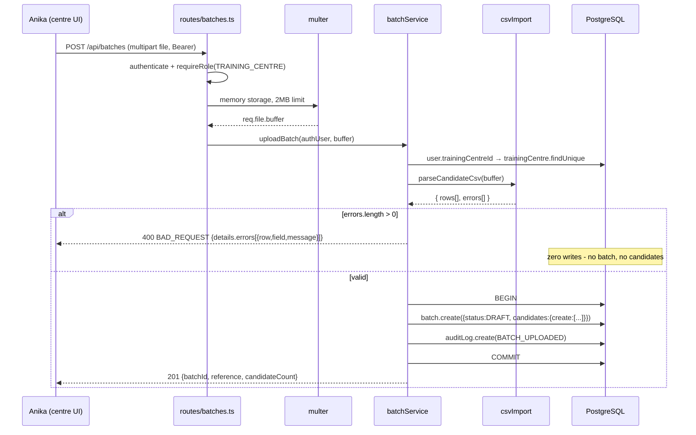
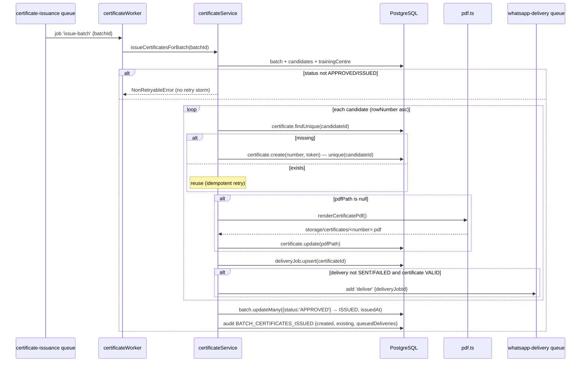

# CertiFlow — End-to-End Runtime Flows

Every flow below is written from the code that actually runs. File → function → effect.

Legend: `file.ts :: function` then the observable result.

---

## 0. Application bootstrap

```
npm run dev:backend
└─ root package.json → npm run dev --workspace server
   └─ server/package.json → tsx watch src/index.ts
      └─ src/index.ts → startServer() in src/app.ts
```

1. `config/env.ts` loads `server/.env` (`dotenv`), validates **all** variables with Zod.
   Invalid config → prints each issue → `process.exit(1)`.
2. `startServer()` runs `prisma.$queryRaw\`SELECT 1\``.
   Failure → prints `DATABASE_URL`, service check hint (`Get-Service postgresql*`) and exits 1.
3. `queue/dispatch.ts :: resolveQueueMode()` runs **once** and is cached:
   * `QUEUE_MODE=sync` → `{ mode: 'sync', reason: 'QUEUE_MODE=sync …' }`
   * otherwise `lib/redis.ts :: checkRedis()` (lazy connect, 2.5 s cap, **no retry storm**)
     * PING ok → `bullmq`
     * PING failed + `QUEUE_MODE=bullmq` → throw with installation instructions → exit 1
     * PING failed + `auto` → `sync`, and the API logs
       `REDIS NOT IN USE … documented fallback`.
4. Express listens on `PORT`; `/storage` is served from `STORAGE_DIR`.
5. `SIGINT`/`SIGTERM` → close HTTP server → `prisma.$disconnect()` → exit 0.

Workers bootstrap independently (`workers/*.ts`): resolve mode, refuse to start with an
explicit message if not `bullmq`, create `Worker` with the shared Redis client, log
`processing …` per job, and on shutdown call `worker.close()` → `closeQueues()` →
`prisma.$disconnect()`.

---

## 1. Demo authentication



Key detail: `authenticate()` **re-reads the user from the database**, so a deleted or
role-changed user cannot keep acting on an old token. `requireRole(...)` then gates the
route; service-level checks (district / training centre) run again inside the service.

Frontend counterpart: `client/src/auth.tsx` (context + localStorage), `client/src/api.ts`
(`api()` adds the bearer, `ApiError` keeps `details` for row errors, 401 clears the session).

---

## 2. Batch upload (CSV) — validation is all-or-nothing



### 2.1 Exactly how the CSV is parsed (`services/csvImport.ts`)

1. **Package**: `csv-parse/sync` → `parse(content, options)`.
   Options: `skip_empty_lines`, `trim`, `bom: true`, `relax_column_count: true`, and a
   `columns` **function** that maps each header through `normaliseHeader` +
   `HEADER_MAP`, so `Full Name`, `full_name`, `candidate_name` all become `name`;
   `mobile`, `phone_number` become `phone`, etc.
2. **Parse failure** → one error `{row: 0, field: 'file', message: 'Could not parse CSV: …'}`.
3. **Empty file** → `{row: 0, field: 'file', message: 'The file contains no candidate rows'}`.
4. **Header check** → any missing required column produces a single `row: 1, field: 'header'` error.
5. **Per row** (`index + 2`, because line 1 is the header and sheets are 1-based):
   * `zod` `rowSchema.safeParse` → collects **all** field issues (name ≥ 2 chars,
     identifier 3–64 chars, course ≥ 2 chars, phone present).
   * `normalisePhone()` strips spaces/`()`/`.`/`-`, then requires `^\+?\d{8,15}$`;
     an invalid phone adds `{field:'phone'}` unless Zod already reported the phone field
     (avoids duplicate messages).
   * **Duplicate identifier** inside the file → `{field:'identifier', message: 'Duplicate identifier "X" (also used on row N)'}`.
   * Only rows with **zero** errors are appended to `rows`.
6. Returns `{ rows, errors }`. `batchService.uploadBatch` throws `400` when `errors.length > 0`
   — the transaction is never opened, so nothing can be partially saved.

### 2.2 Batch creation details (`batchService.ts :: uploadBatch`)

* Requires `authUser.trainingCentreId`; centre's `district` is copied onto the batch.
* `course` = the single distinct course, otherwise `"Mixed courses"`.
* Reference = `CFB-${YYMMDD}-${4 random base36 chars}`, with up to 5 uniqueness retries.
* `prisma.$transaction`: `batch.create` (nested `candidates.create`) + audit
  `BATCH_UPLOADED {reference, candidates}`.
* `P2002` (unique violation) → `409 Duplicate candidate identifier found inside the batch`.
* `.xlsx` is intentionally unsupported; the API rejects a request with neither `file`
  nor `{csv}` with a message telling the user to export to CSV.

**Frontend**: `pages/UploadBatchPage.tsx` posts `FormData` directly to `/api/batches`
(Fetch + bearer), renders `error.details.errors` row-by-row through `ErrorBox`
(`ui.tsx`), offers a "Download sample CSV" generated in-memory via `Blob`.

---

## 3. Submit / resubmit

```
POST /api/batches/:id/submit      requireRole(TRAINING_CENTRE) → submitBatch()
POST /api/batches/:id/resubmit    requireRole(TRAINING_CENTRE) → resubmitBatch()
```

Both use the same transactional pattern:

1. `SELECT id, status, "roundNumber" FROM "Batch" WHERE id = $1 FOR UPDATE`
   → serialises concurrent submits and status changes.
2. Load batch (+ candidates for submit), verify centre ownership (403 otherwise).
3. Submit requires at least one candidate (`400 Cannot submit a batch without candidates`).
4. `stateMachine.ts :: assertTransition`:
   * submit: `DRAFT → PENDING_DISTRICT` (else `409` with the current status)
   * resubmit: `RETURNED → PENDING_DISTRICT`
5. `roundNumber += 1`, create `ApprovalRound(batchId, roundNumber)` (unique per batch),
   set `submittedAt`, `submittedById`; resubmit clears `rejectionReason`.
6. Audit `BATCH_SUBMITTED` / `BATCH_RESUBMITTED` with the previous status and round.

A resubmission always opens a **new round**, so old approvals cannot be reused.

---

## 4. District approval (two distinct officers)

```mermaid
sequenceDiagram
  participant Dev
  participant Meera
  participant API as approvalService
  participant DB as PostgreSQL
  par simultaneous requests
    Dev->>API: POST /:id/decisions {APPROVE}
  and
    Meera->>API: POST /:id/decisions {APPROVE}
  end
  API->>DB: BEGIN; SELECT … FROM "Batch" WHERE id=$1 FOR UPDATE
  Note over DB: second transaction waits for the row lock
  API->>API: assert status=PENDING_DISTRICT, officer.district=batch.district
  API->>DB: approval.create(roundId,officerId,APPROVE)
  API->>DB: approval.count(roundId, APPROVE)
  alt first (count=1)
    API->>DB: audit BATCH_DISTRICT_APPROVAL_RECORDED; COMMIT
    API-->>Dev: 200 {approvals:1, required:2, advancedToState:false}
  else second (count=2)
    API->>DB: round.closedAt=now; batch.status=PENDING_STATE
    API->>DB: audit BATCH_DISTRICT_APPROVED; COMMIT
    API-->>Meera: 200 {approvals:2, advancedToState:true}
  end
```

Guards, in order (`approvalService.ts :: recordDistrictDecision`):

1. `requireRole(DISTRICT_OFFICER)` at the route; role re-checked in the service.
2. `RETURN`/`REJECT` without a reason → `400 A reason is required …`.
3. `FOR UPDATE` lock → then:
   * batch not found → `404`
   * `row.district !== user.district` → `403 This batch belongs to another district`
   * `row.status !== 'PENDING_DISTRICT'` → `409` with `{currentStatus}`
   * no open round (`closedAt` set / missing) → `409 There is no open approval round`
4. **RETURN / REJECT**: insert `Approval`, close round, `assertTransition` →
   `RETURNED` / `REJECTED`, store `rejectionReason`, audit
   `BATCH_RETURNED_BY_DISTRICT` / `BATCH_REJECTED_BY_DISTRICT`. Response
   `{advancedToState:false, message}`.
5. **APPROVE**: insert `Approval` inside `try/catch`:
   * `P2002` → `409 You have already recorded a decision for this approval round`
     (this is the same officer approving twice, including concurrent double-clicks)
   * count approvals for the round
   * `>= 2` → close round, `PENDING_DISTRICT → PENDING_STATE`, audit
   * otherwise audit and return `1/2`
6. Third simultaneous officer: after the second commits, the lock holder re-reads
   `PENDING_STATE` → `409` (no third approval row, no second transition).

Why the lock is needed: without `FOR UPDATE`, two `READ COMMITTED` transactions could both
read `PENDING_DISTRICT`, both count `1` after their own insert, and neither would promote
the batch. The lock forces the second transaction to observe the first commit.

---

## 5. State office final approval → issuance request

```
POST /api/batches/:id/state-decision   requireRole(STATE_OFFICE)
```

`approvalService.ts :: recordStateDecision`:

1. `FOR UPDATE` lock; must be `PENDING_STATE` (else `409`).
2. `RETURN`/`REJECT` → `RETURNED` / `REJECTED` + reason + audit (no issuance).
3. `APPROVE` → `assertTransition(STATE_APPROVE)` → `APPROVED`, audit
   `BATCH_APPROVED_BY_STATE`, **commit**, return `{shouldIssue: true}`.
4. Only **after the commit** does `routes/batches.ts` call
   `queue/dispatch.ts :: enqueueCertificateIssuance(batchId)`.

This ordering is deliberate: state approval is durable before any queue interaction, so a
Redis outage cannot lose an approved batch — `POST /api/batches/:id/issue` can re-request
issuance later.

### Queue dispatch decision (`queue/dispatch.ts`)

| Mode | What happens |
| --- | --- |
| `bullmq` | `Queue.add('issue-batch', {batchId}, {jobId: 'issue-batch-<batchId>', attempts: 5, backoff: {type:'exponential', delay:2000}})` on queue `certificate-issuance`, prefix `certiflow` |
| `sync` | `runSync(...)` executes the **same** `issueCertificatesForBatch()` in-process, 2 attempts, 800 ms base delay; promise tracked in `pendingSyncTasks` (`waitForSyncIdle()` for tests/scripts) |

The response includes `queueMode` so the UI (and a reviewer) can see which path was used.

---

## 6. Certificate issuance (worker or fallback)



Details:

* **Certificate number** `CF-${batch.reference}-${rowNumber padded to 3}` — deterministic,
  therefore stable across retries; `Certificate.certificateNumber` is unique.
* **Verification token** `crypto.randomBytes(16).toString('hex')` (32 hex chars) → URL
  `${PUBLIC_BASE_URL}/verify/<token>`.
* **PDF** (`services/pdf.ts`): `fs.promises.mkdir(recursive)`, `PDFDocument` A4 landscape,
  double border, title, candidate name, course, centre name, certificate number, issue
  date, candidate identifier, verification URL and short code; written with a
  `fs.createWriteStream`, path returned relative to `STORAGE_DIR` and persisted.
* **Idempotency**: `findUnique(candidateId)` → reuse; `P2002` during create (concurrent
  worker) → re-read and reuse. PDF is only rendered when `pdfPath` is null.
* **Batch transition**: `updateMany({id, status:'APPROVED'} → ISSUED)` is race-safe if two
  workers run simultaneously.
* **Revoked certificates** are skipped (`continue`) so issuance never re-queues delivery
  for a cancelled certificate.

---

## 7. Simulated WhatsApp delivery

```mermaid
sequenceDiagram
  participant Q as whatsapp-delivery queue
  participant W as notificationWorker
  participant DS as deliveryService
  participant WA as whatsapp.ts (simulator)
  participant DB as PostgreSQL
  Q->>W: job 'deliver' {deliveryJobId}
  W->>DS: processDelivery(deliveryJobId)
  DS->>DB: deliveryJob + certificate + candidate + batch + centre
  alt job already SENT
    DS-->>W: return (no-op)
  else certificate REVOKED
    DS->>DB: status=FAILED, lastError='Certificate was revoked before delivery'
  else
    DS->>DB: attempts += 1
    DS->>WA: sendWhatsAppMessage({phone,message,attempt})
    alt success
      DS->>DB: status=SENT, sentAt, providerRef; audit WHATSAPP_DELIVERED
    else retryable and attempts < WHATSAPP_MAX_ATTEMPTS
      DS->>DB: status=PENDING, lastError; audit WHATSAPP_DELIVERY_FAILED
      DS-->>W: throw → BullMQ retries with exponential backoff
    else permanent or exhausted
      DS->>DB: status=FAILED, lastError; audit WHATSAPP_DELIVERY_FAILED
    end
  end
```

Simulator rules (`services/whatsapp.ts`, mode `mixed`, last digit of the digit-only phone):

| Suffix | Error | `retryable` | Typical outcome |
| --- | --- | --- | --- |
| `7` | permanent failure | `false` | `FAILED` after 1 attempt |
| `8` | gateway timeout | `true` | retries until `WHATSAPP_MAX_ATTEMPTS` → `FAILED` |
| `9` | temporary failure, only on attempt 1 | `true` | attempt 2 succeeds → `SENT` |
| other | — | — | `SENT` on attempt 1 |

`WHATSAPP_MODE=success|failure|timeout` overrides the suffix logic.
Message content: greeting, certificate number, course, verification URL.

**Critical invariant**: delivery never creates a certificate. It only updates
`DeliveryJob` and reads `Certificate`.

Queue settings: delivery job `attempts: WHATSAPP_MAX_ATTEMPTS`, exponential backoff with
1 500 ms base; certificate job `attempts: 5` with 2 000 ms base.

---

## 8. Public verification

```mermaid
sequenceDiagram
  participant Anyone
  participant API as routes/verify.ts
  participant VS as verificationService
  participant DB as PostgreSQL
  Anyone->>API: GET /api/verify/:certificateNumber  (or /token/:token)
  API->>VS: verifyByNumber / verifyByToken
  VS->>DB: certificate.findUnique(+candidate,+batch,+trainingCentre)
  alt none
    VS-->>Anyone: {result:{status:'NOT_FOUND', certificateNumber}}
  else found
    VS-->>Anyone: {result:{status:'VALID'|'REVOKED', candidateName, candidateIdentifier,
                          course, trainingCentre, district, issueDate,
                          revokedAt, revokeReason, verificationToken, verificationUrl, pdfUrl}}
  end
```

* The projection in `verificationService.ts :: toPublicCertificate` **never includes
  `phone`** or any other unnecessary personal data.
* `GET /api/verify/token/:token/pdf` streams the stored PDF for token holders.
* `NOT_FOUND` is a 200 response with `status: 'NOT_FOUND'` (frontend contract), unknown
  tokens return `404`.
* `client/src/pages/VerifyPage.tsx` auto-verifies when the route contains `:token`,
   detects a 32-hex input as a token, otherwise queries by certificate number, and shows
  the status badge + revocation details.

---

## 9. Certificate revocation / cancellation

Two entry points, both `requireRole(STATE_OFFICE)`:

```
POST /api/certificates/:id/revoke            {reason}   → revokeCertificate()
POST /api/batches/:id/revoke-certificates    {reason}   → revokeBatchCertificates()
```

Single certificate (`verificationService.ts :: revokeCertificate`):

1. Reason ≥ 3 chars enforced with Zod in `routes/certificates.ts`; service re-checks.
2. `SELECT id, status, "certificateNumber" FROM "Certificate" WHERE id=$1 FOR UPDATE`.
3. Already `REVOKED` → `409 Certificate is already revoked`.
4. Update `status=REVOKED`, `revokedAt`, `revokedById`, `revokeReason`.
5. `deliveryJob.updateMany({certificateId, status != SENT} → FAILED, lastError:'Certificate revoked before delivery')`
   so no pending WhatsApp message goes out after cancellation.
6. Audit `CERTIFICATE_REVOKED`.

Batch (`revokeBatchCertificates`): one transaction, every `VALID` certificate of the batch
is revoked with the same reason, pending deliveries are failed, and a single
`BATCH_CERTIFICATES_REVOKED` audit row lists the affected certificate ids.
`409 No valid certificates found for this batch` when there is nothing to revoke.

Verification reads the live `Certificate.status`, so `REVOKED` is visible immediately —
no cache to invalidate.

---

## 10. Frontend routing and role flows

`client/src/App.tsx`:

| Route | Guard | Page | Server calls |
| --- | --- | --- | --- |
| `/login` | public | `LoginPage` | `GET /auth/demo-users`, `POST /auth/demo-login` |
| `/dashboard` | `TRAINING_CENTRE` | `TrainingDashboard` | `GET /batches` |
| `/upload` | `TRAINING_CENTRE` | `UploadBatchPage` | `POST /batches` (multipart) |
| `/officer` | `DISTRICT_OFFICER` | `OfficerQueuePage` | `GET /batches` (filtered client-side to `PENDING_DISTRICT`) |
| `/state` | `STATE_OFFICE`, `QUALITY_TEAM` | `StateQueuePage` | `GET /batches` |
| `/batch/:id` | any authenticated | `BatchDetailPage` | `GET /batches/:id`, all action endpoints |
| `/verify`, `/verify/:token` | public | `VerifyPage` | `GET /verify/...` |

`BatchDetailPage` is the single action surface; it renders buttons **only** from the
server-computed `ui.actions` array (`routes/batches.ts :: availableActions`):

| Action | Condition (computed server-side) |
| --- | --- |
| `SUBMIT` | role centre **and** owns batch **and** `DRAFT` |
| `RESUBMIT` | role centre **and** owns batch **and** `RETURNED` |
| `DISTRICT_DECISION` | role officer **and** same district **and** `PENDING_DISTRICT` **and** no decision yet in the current round |
| `STATE_DECISION` | role state **and** `PENDING_STATE` |
| `RETRY_ISSUANCE` | role state **and** `APPROVED` |
| `REVOKE_CERTIFICATES` | role state **and** (`APPROVED` or `ISSUED`) |

The same endpoint also returns the approval rounds with officer names/decisions, the
candidate table, certificates with `DeliveryJob` status/attempts, and an audit trail
(batch + certificates + delivery jobs joined on entity ids).

UI never sends a raw status change: every mutation is a named business endpoint.

---

## 11. Error paths at a glance

| Situation | HTTP | Code | Where produced |
| --- | --- | --- | --- |
| Invalid credentials / missing token | 401 | `UNAUTHORIZED` | `auth/middleware.ts` |
| Wrong role / other district / other centre | 403 | `FORBIDDEN` | middleware + services |
| Invalid CSV rows | 400 | `BAD_REQUEST` + `details.errors[]` | `csvImport` + `uploadBatch` |
| Invalid request body | 400 | `VALIDATION_ERROR` | `middleware/errorHandler.ts` (Zod) |
| Illegal status transition / duplicate approval / already revoked | 409 | `CONFLICT` (+ `details`) | `stateMachine`, `approvalService`, `verificationService` |
| Unknown id | 404 | `NOT_FOUND` | services |
| File > 2 MB | 400 | `UPLOAD_ERROR` | `errorHandler` (multer) |
| Prisma unique/foreign-key violation | 409 | Prisma code | `errorHandler` |
| Database unreachable | 503 | `DB_UNAVAILABLE` | `errorHandler` / startup exit 1 |
| Unexpected | 500 | `INTERNAL` | `errorHandler` (stack logged server-side only) |

Retry classification: `NonRetryableError` (unknown batch, batch not approved, missing
delivery job) is never retried; `WhatsAppError.retryable` decides delivery retries.

---

## 12. Idempotency & concurrency summary

| Scenario | Mechanism | Result |
| --- | --- | --- |
| Duplicate CSV upload handling mistake (retry after 400) | No writes on validation failure | Zero batches/candidates |
| Same officer clicks Approve twice | `Approval @@unique([roundId, officerId])` → `P2002` | Second call `409`, one row |
| Dev + Meera approve simultaneously | `FOR UPDATE` lock + count inside tx | Two rows, one transition |
| Third officer approves off the back of two | Status re-check under lock | `409`, no extra row |
| Issuance job delivered twice | `Certificate.candidateId` unique + re-read; `pdfPath` check | Same certificate/PDF |
| Two workers issue the same batch | `updateMany({status:'APPROVED'})` + unique constraints | One `ISSUED` transition |
| Delivery job retried | `DeliveryJob.attempts` persisted before each attempt | Attempts tracked, no new certificate |
| Revoke while delivery pending | Delivery reads certificate status; revocation fails pending jobs | No message for revoked cert |
| Certificate number guessing | Random 128-bit `verificationToken` on the PDF URL | Enumeration impractical |
